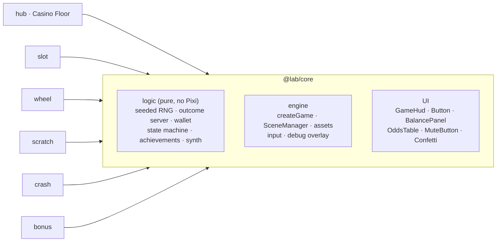
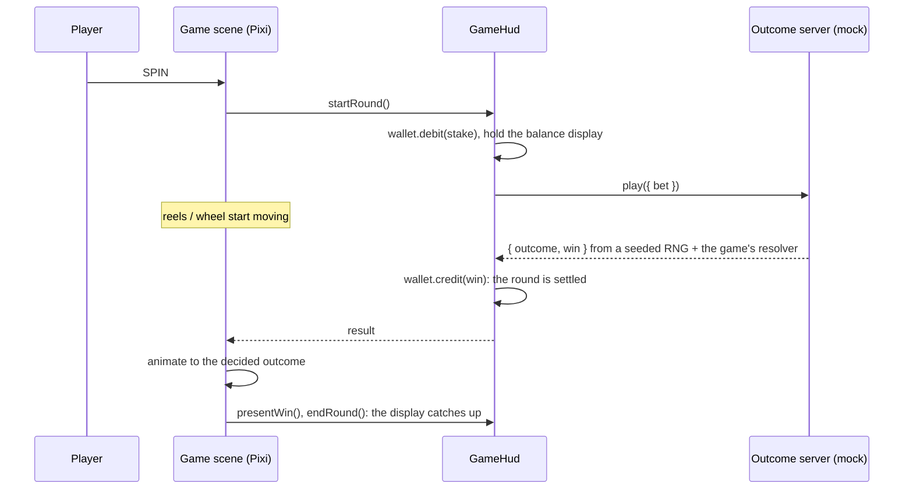

# iGaming Canvas Lab

Five small casino games built with **PixiJS v8 + TypeScript**, behind a playable arcade landing
page. Every round is decided by a (mock) server and only animated by the client, the game maths
is unit-tested, and every game works in portrait and landscape.

**Live:** <https://igaming-canvas-lab.vercel.app>

| Game                                                           | Shows                                                               |
| -------------------------------------------------------------- | ------------------------------------------------------------------- |
| [Mini Slot](https://igaming-canvas-lab.vercel.app/slot/)       | Masked reel strips, reel splicing, slam-stop, exact RTP enumeration |
| [Lucky Wheel](https://igaming-canvas-lab.vercel.app/wheel/)    | Weighted outcomes, angle maths, velocity-matched custom ease        |
| [Scratch Card](https://igaming-canvas-lab.vercel.app/scratch/) | RenderTexture brush, CPU coverage grid, pooled confetti             |
| [Crash](https://igaming-canvas-lab.vercel.app/crash/)          | Real-time curve, easing camera, server-timed cash-out race          |
| [Bonus Round](https://igaming-canvas-lab.vercel.app/bonus/)    | Rigged mascot, coin particles, BIG/MEGA/EPIC roll-up (`?demo=epic`) |

## Stack

PixiJS v8 · TypeScript (strict) · Vite · GSAP · @pixi/sound · Vitest · pnpm workspaces · GitHub
Actions · Vercel

## Architecture



```
packages/core   shared engine; `@lab/core/logic` is the Pixi-free part that tests import
apps/hub        the Casino Floor landing page (plus a hidden HTML list of the games for crawlers)
apps/<game>     one Vite app per game, served at /<game>/; maths in src/logic, Pixi in src/view
scripts/        assemble.mjs merges every app build into dist/ for Vercel
```

### How a round works

The outcome is decided before anything moves, the way a real game server works. The client's
job is to animate towards a result it was handed, never to decide one.



Each game supplies only a pure **resolver** (stake + RNG → outcome + win). `MockOutcomeServer`
adds the seeded RNG and fake network latency. The crash game has its own `MockCrashServer`,
because cash-outs are judged on the server's clock while the round is running.

### Performance notes

- **Bake vector art once.** Slot symbols, the wheel face, scratch coins and particle textures are
  drawn with `Graphics` and turned into textures with `generateTexture` at the screen's
  resolution, so gameplay is batched sprites.
- **Masks and text.** One rectangular mask covers all slot reels, and fast-changing numbers (win
  counters, the crash multiplier) use `BitmapText`.
- **Pooled particles.** `Confetti` is a `ParticleContainer` with pre-allocated pieces, recycled
  across bursts (one draw call). It skips rendering while idle.
- **No GPU readback.** The scratch card tracks coverage on a CPU grid stamped with the same brush
  strokes it paints into the `RenderTexture`.
- **Work moved out of the frame.** RTP and odds are computed at build time (Vite `define`). The
  ticker pauses on hidden tabs, and resolution is capped at 2×.
- **Light first load.** Each game loads 154–160 KB of gzipped JS. The landing page paints a CSS
  boot screen from 1.7 KB of JS, then loads Pixi and the floor on demand: about 225 KB gzipped,
  plus about 40 KB of web fonts.
- **Measured.** `?debug=1` on any page shows FPS, WebGL draw calls per frame (about 9–21 in
  the games, about 80 on the arcade floor with bloom on), node count, and the floor's quality
  tier and post-processing state.

### Testing

`pnpm test` runs 105 tests over the pure logic, in milliseconds and without a browser:

- exact RTP by enumerating every reel stop, cross-checked against seeded simulations
- prizes, segments and stops drawn as often as their weights say
- the wheel's angle maths round trip, the ease's shape and starting slope
- the scratch card's layouts and coverage grid geometry
- the crash latency race on fake timers: a cash-out that looks safe on screen loses if it
  reaches the server after the crash
- the bonus count-up plan, wallet and badge persistence, the state machine and the WAV synth

CI (GitHub Actions) runs typecheck, lint, tests and the full build on every push and PR.

### URL flags

| Flag                         | Where    | Does                                                       |
| ---------------------------- | -------- | ---------------------------------------------------------- |
| `?debug=1`                   | any page | FPS, draw calls and node count overlay                     |
| `?quality=high\|medium\|low` | hub      | pins the floor's quality tier instead of auto-detecting it |
| `?seed=123`                  | any game | replays the same sequence of rounds                        |
| `?demo=big\|mega\|epic`      | bonus    | every pick lands that win tier (says so on screen)         |

## Mini Slot (`apps/slot`)

A 3×3, 5-line slot. Space spins, pressing it again slam-stops the reels, and ↑/↓ change the bet.

- **Server-decided outcome.** `MockOutcomeServer` picks a stop on each physical reel strip and
  settles the win. The client only animates towards that result.
- **Reel splicing.** Each reel recycles 4 sprites under one rectangular mask. When the result
  arrives, the strip positions that are still off screen are remapped to the result, so the reel
  lands exactly on it after a short back-eased run without any visible jump. The landing tween's
  starting speed matches the spin speed.
- **Maths you can check.** `exactStats()` walks all 24³ stop combinations: **RTP 96.6%**, hit
  rate 21% (1 in 4.7), max win 160× the stake. A unit test checks those figures and compares them
  with a 200,000-spin seeded simulation.
- **Cheap rendering.** Symbols are drawn once as vector `Graphics` and baked into textures with
  `generateTexture`, so the reels are plain batched sprites. Counters use `BitmapText`, and a
  slight vertical stretch fakes motion blur without a filter pass. About 10 draw calls per frame
  (`?debug=1`).
- **Display balance vs real balance.** The wallet is credited as soon as the result arrives. The
  balance panel holds the old figure until the win count-up has finished.

## Lucky Wheel (`apps/wheel`)

A 12-segment prize wheel. Space spins, and pressing it again makes the wheel land faster.

- **Weighted, server-decided outcome.** The segments look equal, but the server picks one by
  weight, and also picks where inside it the pointer stops, so seeded replays are exact.
  `exactStats()` gives **RTP 95.6%**, with a 50× jackpot at 0.4%; the odds panel shows the same
  figures.
- **Angle maths.** `targetRotation()` finds the forward rotation, at least a minimum distance away,
  that puts the chosen spot under the pointer. Tests check this round trip on 500 random cases.
- **Custom ease.** `createWheelEase()` decelerates on a power curve, creeps just past the target
  and settles back with a cosine, so the pointer sometimes slips over a peg and back. The tween
  duration is chosen so the ease's starting speed equals the free-spin speed, so there's no jolt
  when the result arrives.
- **Pointer flicks.** Pegs crossing the pointer, forwards or backwards, are counted from the
  rotation each frame and kick the pointer with an elastic spring, plus a throttled tick sound.
- **Cheap rendering.** The face (12 wedges, labels and pegs) is baked into one texture, and the
  rim bulbs share one tinted texture. About 10 draw calls per frame.

## Scratch Card (`apps/scratch`)

A match-3 scratch card. Drag to scratch, or press REVEAL or Space.

- **RenderTexture scratching.** The prizes sit above a silver foil and are masked by a
  `RenderTexture`. Each pointer move paints a round-capped stroke from the last point into it, so
  fast swipes leave no gaps.
- **Coverage without GPU readback.** The same strokes are stamped into a 48×48 `CoverageGrid` in
  memory, which gives per-prize and whole-card coverage cheaply instead of reading pixels back
  every frame. A prize counts as seen at 50%, and past 62% the rest wipes away on its own.
- **Server-decided card.** The prize is drawn first (RTP 94%, a win on 1 card in 3.2). The card is
  then laid out with exactly three of the winning symbol and no other triple, and tests check
  thousands of layouts.
- **Pooled confetti.** `Confetti` in `@lab/core` is a `ParticleContainer` of 400 pre-allocated
  quads (one draw call) recycled across bursts, also used for foil flakes while scratching.

## Crash (`apps/crash`)

Bet, watch the multiplier climb, and cash out before it crashes. Space bets and cashes out, and A
cycles the auto cash-out target.

- **Server-authoritative timing.** `MockCrashServer` draws the crash point when the round starts
  and keeps it secret until it pushes the crash. Cash-outs are judged on the server's clock when
  the request arrives, so network delay counts against the player. The animation is never the
  authority. A test shows a request that looks safe on screen losing because it reached the
  server after the crash.
- **Heavy-tailed maths.** `crashPointFrom(r) = 0.97 / (1 − r)`, rounded down to hundredths, gives
  P(reach x) = 0.97 / x. About 4% of rounds bust at 1.00×, and auto cash-out at 2× returns
  96.5%. Tests check the distribution and the RTP against 200,000 simulated rounds.
- **Real-time chart.** The curve is redrawn each frame from `e^(0.15·t)`, and the axes ease
  towards the tip so the view zooms out as the multiplier climbs. The rocket follows the curve's
  on-screen slope, and stars stream past faster as it climbs. Numbers use `BitmapText`. About
  9 draw calls per frame.
- **Race-safe client.** An instant bust can arrive before the start acknowledgement, and a
  cash-out verdict can arrive after the crash message. Both are handled, and a confirmed cash-out
  is always credited.

## Bonus Round (`apps/bonus`)

Pick one of three chests (click, or press 1, 2 or 3). Big prizes set off the celebration.
`?demo=big`, `?demo=mega` or `?demo=epic` forces that tier so the sequence can be seen without
waiting for a rare draw, and the screen says so.

- **Server-decided pick.** The pick is cosmetic: the server decides the prize, and what the
  other two chests held, when the chest is picked. RTP is 97%, a pick pays on 63% of tries, and a
  BIG WIN or better comes up 1 in 50.
- **BIG → MEGA → EPIC roll-up.** `planCountUp()` turns a win into contiguous steps: the banner
  starts at BIG and upgrades as the counter passes 25× and 50× the stake. Each upgrade fires a
  coin burst, a screen shake and a sound, and the whole thing is one GSAP timeline that Space or
  a tap skips to the end. Tests check the steps.
- **Coin shower.** A pooled `ParticleContainer` (`Confetti` from `@lab/core` with a coin
  texture) holds 360 coins that spin by squashing their x scale. It's one draw call.
- **Rigged mascot, ready for Spine.** "Lucky" is a skeleton of bone containers (body, face, arms
  and legs on their joints) animated by GSAP timelines: idle, anticipate, cheer, celebrate and
  sad. The scene only calls `play(animation)`, so a `spine-pixi-v8` skeleton could take its
  place. Spine isn't used yet: its runtime licence requires a Spine Editor licence to publish a
  site that runs it.

## The Casino Floor (`apps/hub`)

The landing page is a game too: a synthwave arcade with one cabinet per game. Nothing to
learn: hover (or use the arrow keys) to light a cabinet, and click (or press Enter) to zoom into
its screen and open the game. On phones the row becomes a swipeable carousel with dots.

- **Attract mode.** Each cabinet's screen loops a tiny preview of its game: spinning reels, a
  coasting wheel, a foil wipe, a crash curve, a bouncing mascot.
- **Cabinets drawn in code.** Gradient shells edged with a neon tube (glow, halo and a white-hot
  core), lit marquees with chasing bulbs, joysticks, buttons and coin doors, and a pool of light
  with tube reflections on the grid. The selected cabinet lifts, its bulbs chase faster and its
  tube buzzes now and then.
- **CRT screens** (`floor/crt-filter.ts`): one shared filter adds barrel curvature, scanlines, a
  rolling bright band, edge chromatic aberration and a vignette. `filterArea` pins it to the tube,
  however far the attract art pokes out. Its vertex shader passes the frame mapping as varyings,
  so the fragment shader never redeclares Pixi's frame uniforms; shared uniforms must have the
  same precision in both stages, and Pixi gives the stages different defaults. Off on the low
  quality tier.
- **Into the game.** Clicking zooms into the screen, which then switches off like a CRT: a white
  frame collapses to a line, then a dot, with a synthesized whine and click.
- **Synthwave horizon in GLSL.** The sky and the floor are one shader quad each
  (`floor/synthwave-shaders.ts`). The sky draws a dusk gradient, twinkling hashed stars and a
  striped sun whose bands slide into the horizon. The floor draws an endless neon grid that
  scrolls toward the viewer, with depth from `z = K / (y - horizon)` instead of 3D geometry.
  Grid lines are anti-aliased analytically in pixels (no derivatives extension), and they fade
  out before they get dense enough to cause moiré. Panning the camera shifts world x by a
  constant, so near lines move more than far ones: parallax for free. Two wireframe mountain
  ranges sit between them as parallax layers. The art extends past the design area, so any
  screen shape is filled.
- **Chrome and neon type.** The title is 80s chrome: a `FillGradient` with a hard horizon line,
  plus a glint that sweeps across it through a moving stencil mask. "Casino Floor" is a neon
  script. The neon look (hot core, coloured tube, glow) is baked into the text texture with
  `dropShadow`, so it costs no filter passes.
- **Power-on intro.** On the first visit of a session, the horizon fades up, the title drops
  in, the script strikes like a real tube (a scripted stutter with a synthesized mains buzz),
  and the cabinets light up one by one before the HUD comes on. Any key or tap skips to the end.
- **Badges and HIRE ME.** Each game awards one badge (shared through `@lab/core`'s
  `Achievements` in localStorage, with an in-game toast). The credits and badges show on the
  floor, and earning all five lights the HIRE ME neon sign, which opens the contact panel at any time.
- **Boot screen.** While Pixi downloads, a synthwave horizon in plain HTML and CSS (striped sun,
  scrolling perspective grid, chrome title, scanlines) shows real loading milestones, then
  switches off like a CRT into the floor's power-on intro. It costs no JavaScript beyond the hub's
  entry script, and a failed load turns it into a retry button.
- **Crawler-friendly.** A plain HTML list of the games is always in the page, visually hidden,
  for search engines, link previews and screen readers.
- **Bloom and grade.** The whole stage goes through pixi-filters' `AdvancedBloomFilter`, tuned so
  only the hottest pixels (tube cores, bulbs, the sun) bloom, then a one-pass vignette and film
  grain. `stage.filterArea = app.screen` keeps the passes screen-sized, even though the backdrop
  bleeds far past the screen. Motes drifting up through the scene are one additive
  `ParticleContainer`.
- **Quality tiers** (`floor/quality.ts`, unit-tested). The floor starts from a hardware guess
  (memory, cores, touch) and then judges 2-second windows of raw frame time. It steps down one
  tier when frames are slow and uneven, or below ~25 fps however steady they are. A steady
  30 fps cap, such as Low Power Mode, is treated as a choice, not as slowness. It never steps
  back up, so it can't oscillate. `?quality=high|medium|low` pins a tier.

  | Tier   | Resolution cap | CRT screens | Bloom + grade   | Motes |
  | ------ | -------------- | ----------- | --------------- | ----- |
  | high   | 2×             | on          | full resolution | 100%  |
  | medium | 1.5×           | on          | half resolution | 60%   |
  | low    | 1×             | off         | off             | 25%   |

- **Easter egg.** The Konami code makes it rain coins.

## Development

```bash
corepack enable
pnpm install
pnpm dev          # every app; open http://localhost:5173 (the hub proxies /slot/ etc.)
pnpm test         # unit tests (pure game logic, no Pixi)
pnpm typecheck && pnpm lint
pnpm build        # builds every app into dist/
```

## License

MIT. Third-party assets are listed in [CREDITS.md](CREDITS.md).
